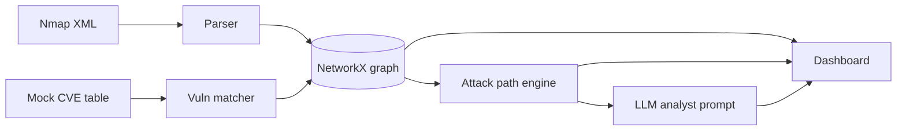

# Attack Path Engine

**Threat-modeling prototype that turns Nmap scan results into an asset/service/vulnerability graph, computes attack paths between hosts, and produces an analyst-style explanation with mitigations.**

## Overview

Defenders often have scan data (open ports, service versions) but no clear picture of how an attacker could chain exposed services and known vulnerabilities to move from one host to another. This project builds a small pipeline for that:

1. **Ingest** an Nmap XML scan (hosts, OS guesses, open ports, service product and version).
2. **Model** the environment as a directed graph: `Asset -[RUNS]-> Service -[AFFECTED_BY]-> Vulnerability`.
3. **Match** discovered services against a CVE dataset.
4. **Compute** candidate attack paths between a source and a target host with NetworkX, ranked by a risk score (sum of CVSS scores along the path).
5. **Explain** the top path in plain language with three mitigation steps, using an LLM-analyst prompt.
6. **Visualize** the graph in a web dashboard (vis-network).

> **Prototype status, stated honestly:**
> - The graph is stored **in memory with NetworkX**. Neo4j settings exist in `core/config.py` (the original design target), but the running pipeline does not use Neo4j.
> - The CVE matcher uses a small **mock CVE table** (Apache httpd 2.4.41, PostgreSQL 14.2) for the demo, not a live NVD feed.
> - The LLM analyst **builds the real prompt but returns a templated (mocked) response**. The call to the Gemini API is left as commented code.
> - A demo `CONNECTED_TO` edge between `192.168.1.10` and `192.168.1.20` is added at startup to simulate lateral reachability.

## Key features

- Nmap XML parser (open ports only, service product and version, OS match)
- Graph modeling of assets, services and vulnerabilities
- CVE matching against product and version
- Top-5 shortest simple paths with CVSS-based risk ranking
- LLM-ready path explanation endpoint (prompt plus mitigation report)
- Single-page dashboard: load the demo scan, match vulnerabilities, compute a path, get the AI explanation
- REST API with Swagger docs (FastAPI)

## Tech stack

| Component | Technology |
|---|---|
| API | Python, FastAPI, Uvicorn, Pydantic Settings |
| Graph and algorithms | NetworkX (in-memory) |
| Parsing | `xml.etree.ElementTree` (Nmap XML) |
| Frontend | HTML/JS, vis-network, Font Awesome |
| Planned | Neo4j graph database, Gemini LLM |

## Project structure

```
attack-path-engine/
└── backend/
    ├── main.py               # FastAPI app, mounts dashboard at /dashboard
    ├── api/
    │   ├── nmap.py           # POST /api/nmap/upload, POST /api/nmap/load-dummy
    │   └── analysis.py       # match-vulns, graph, attack-path, explain-path
    ├── parsers/nmap_parser.py
    ├── graph/                # ingestion + demo schema/edges
    ├── engine/
    │   ├── vuln_matcher.py   # mock CVE database + matching
    │   └── attack_path.py    # NetworkX path finding + risk score
    ├── ai/llm_analyst.py     # prompt building + mocked LLM response
    ├── core/                 # settings, in-memory graph store
    ├── static/index.html     # dashboard
    ├── tests/dummy_nmap.xml  # sample scan (private lab IPs)
    ├── populate_db.py        # script that runs the pipeline over HTTP
    └── requirements.txt
```



## Getting started

### Prerequisites

- Python 3.10+

### Install

```bash
cd backend
python -m venv venv
# Windows
venv\Scripts\activate
# Linux / macOS
source venv/bin/activate

pip install -r requirements.txt
```

### Configuration

None is needed for the current in-memory version. `backend/.env.example` lists the placeholder Neo4j settings that `core/config.py` reads (`NEO4J_URI`, `NEO4J_USER`, `NEO4J_PASSWORD`). They are kept for the planned Neo4j backend. Copy the file to `backend/.env` if you need them.

### Run

```bash
cd backend
uvicorn main:app --reload
```

- Dashboard: http://localhost:8000/ (redirects to `/dashboard/index.html`)
- API docs: http://localhost:8000/docs

## Usage

From the dashboard, click through: **load demo scan**, then **match vulnerabilities**, then **compute attack path**, then **AI explanation**.

Or use the API directly:

```bash
# 1. Upload a scan (or POST /api/nmap/load-dummy to use the bundled sample)
curl -F "file=@tests/dummy_nmap.xml" http://localhost:8000/api/nmap/upload

# 2. Match vulnerabilities
curl -X POST http://localhost:8000/api/analysis/match-vulns

# 3. Attack paths
curl "http://localhost:8000/api/analysis/attack-path?source_ip=192.168.1.10&target_ip=192.168.1.20"

# 4. Analyst explanation
curl "http://localhost:8000/api/analysis/explain-path?source_ip=192.168.1.10&target_ip=192.168.1.20"

# Whole graph (nodes/edges for visualization)
curl http://localhost:8000/api/analysis/graph
```

`populate_db.py` runs steps 1-3 automatically. It targets `http://127.0.0.1:5050`, so either start the server with `uvicorn main:app --port 5050` or edit `base_url` in the script.

## Roadmap

- Persist the graph in Neo4j (settings already scaffolded)
- Replace the mock CVE table with NVD / CPE-based matching
- Wire the analyst to a real LLM via `GEMINI_API_KEY`
- Derive host reachability from traceroute, routing or firewall data instead of a demo edge

## Responsible use

Only scan networks you own or are explicitly authorized to assess. The bundled sample uses private lab addresses.

## Academic context

Cybersecurity engineering project (ING4 SSIR track), TEKUP, Tunisia, 2025–2026.

## Author

**Nasrallah Hadhri**: [github.com/Nasrallah-Hadhri](https://github.com/Nasrallah-Hadhri)

## License

[MIT](LICENSE)
